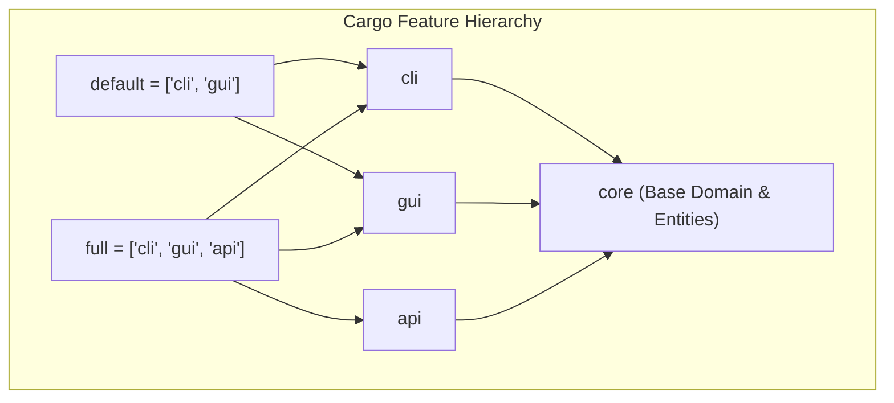

# Cargo Feature Flags & Packaging Architecture - `dvd-ripper`

`dvd-ripper` is packaged as a dual-mode Rust crate:
1. **A reusable, modular library crate** (`dvd_ripper`) exposing domain entities, ports, application use cases, and infrastructure adapters.
2. **A native desktop application & CLI binary** (`dvd-ripper.exe` / `dvd-ripper`) alongside a standalone installer (`dvd-ripper-installer`).

This document provides a comprehensive guide to crate features, headless server compilation, graphical desktop builds, and Windows PE subsystem handling.

---

## 1. Feature Flag Taxonomy

`dvd-ripper` follows the **Cargo Feature Segregation Pattern** to minimize build times, binary footprints, and dependency bloat:



### Feature Flag Matrix

| Feature | Default? | Primary Dependencies | Description |
| :--- | :---: | :--- | :--- |
| **`default`** | **Yes** | `["cli", "gui"]` | Standard out-of-the-box user build supporting both desktop window GUI and full CLI execution. |
| **`core`** | No | None (zero external framework) | Pure domain logic, entities, ports, IFO/BUP parsers, and heuristics without GUI or CLI dependencies. |
| **`cli`** | In `default` | `clap`, `serde`, `serde_json` | Command-line interface parser, batch runner, argument validation, and terminal logging. |
| **`gui`** | In `default` | `eframe`, `egui`, `rfd`, `image` | Native immediate-mode desktop GUI window with hardware acceleration, theme engine, and file pickers. |
| **`api`** | No | `std::net`, `subtle` | Embedded HTTP REST server, Server-Sent Events (SSE) broadcast engine, and Prometheus `/metrics` exporter. |
| **`full`** | No | All features (`["cli", "gui", "api"]`) | Complete distribution bundle combining GUI, CLI, and embedded HTTP/SSE daemon capabilities. |

---

## 2. Windows PE Subsystem & Process Attachment

A common challenge in hybrid GUI/CLI applications on Microsoft Windows is preventing an empty black command prompt console window from appearing when the user double-clicks the application executable.

### 2.1 The Windows Subsystem Directive
In `src/main.rs`, the Windows Portable Executable (PE) header subsystem is explicitly defined:

```rust
#![windows_subsystem = "windows"]
```

- When compiled with the `gui` feature enabled, Windows launches the process in GUI mode (`IMAGE_SUBSYSTEM_WINDOWS_GUI`), allocating **no console window**. The `eframe`/`egui` native window is created directly via the Windows DWM (Desktop Window Manager).

### 2.2 Parent Console Attachment in CLI Mode
When a user executes `dvd-ripper --cli` or `dvd-ripper -h` from PowerShell or Command Prompt, standard output must print back to the invoking terminal. `dvd-ripper` dynamically attaches to the caller's console:

```rust
#[cfg(target_os = "windows")]
unsafe {
    unsafe extern "system" {
        fn AttachConsole(dwProcessId: u32) -> i32;
    }
    AttachConsole(0xFFFFFFFF); // ATTACH_PARENT_PROCESS
}
```

This delivers seamless dual behavior:
- **Double-clicking executable**: Launches native desktop GUI with zero console popup.
- **Invoking from terminal**: Binds to terminal stdout/stderr for interactive CLI output and piping.

> [!IMPORTANT]
> Because `#![windows_subsystem = "windows"]` silences standard console allocation, `default` in `Cargo.toml` **must** include `"gui"`. If built with only `"cli"`, double-clicking the application from the desktop falls through to CLI mode, cannot find an optical disc, and exits silently without showing any error dialog.

---

## 3. Building for Different Environments

### 3.1 Standard Desktop Build (GUI + CLI)
Includes both graphical window and command-line execution (default):

```bash
cargo build --release
```
- Output: `target/release/dvd-ripper` (~7.1 MB with LTO and symbols stripped).

### 3.2 Headless Server / Container Daemon Build
For headless Linux servers, Docker containers, or NAS appliances without X11/Wayland desktop libraries:

```bash
cargo build --release --no-default-features --features cli,api
```
- Completely removes `eframe`, `egui`, `rfd`, and OpenGL/Vulkan GUI dependencies.
- Drastically reduces compile times and dependencies.

### 3.3 Full Embedded Appliance Build
Includes all capabilities including the remote Web Dashboard and Prometheus metrics exporter:

```bash
cargo build --release --features full
```

---

## 4. Consuming `dvd-ripper` as a Library

External Rust applications can depend directly on `dvd-ripper` by specifying selective features in `Cargo.toml`:

```toml
[dependencies]
# Headless library integration without GUI or CLI overhead
dvd-ripper = { version = "0.4", default-features = false, features = ["core"] }
```

### Example Library Usage:

```rust
use dvd_ripper::prelude::*;

fn main() -> anyhow::Result<()> {
    // 1. Build composition container
    let container = AppContainer::build_production("ffmpeg");

    // 2. Inspect optical disc
    let probe_uc = container.probe_disc_use_case();
    let result = probe_uc.execute(&std::path::PathBuf::from("/dev/sr0"))?;

    println!("Detected DVD: {}", result.info.volume_label);
    for title in &result.info.titles {
        println!(" - Title #{}: {:.1} mins", title.title_num, title.duration_secs / 60.0);
    }

    Ok(())
}
```
