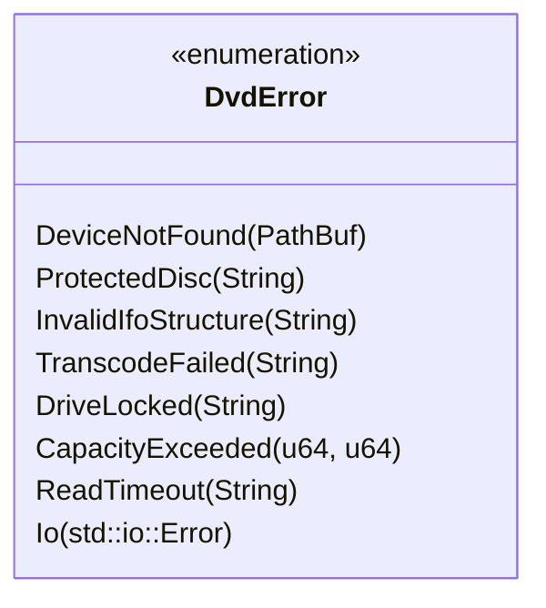
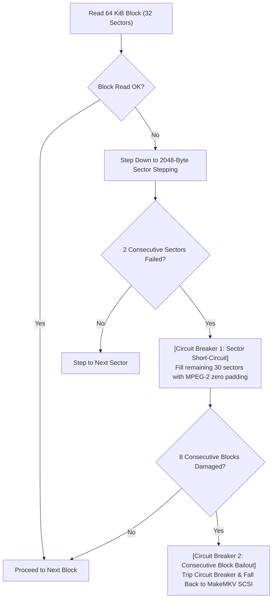

# Domain Errors, Circuit Breakers & Fault Tolerance - `dvd-ripper`

`dvd-ripper` treats optical media handling as inherently unreliable. Physical discs may suffer from severe surface scratches, corrupt file structures, aggressive anti-copy bad sector traps (Sony ARccOS, Macrovision RipGuard), or abrupt hardware device disconnection.

This document details the typed domain error architecture, circuit breaker patterns, and cooperative fault-tolerance strategies implemented in `dvd-ripper`.

---

## 1. Domain Error Taxonomy: `DvdError`

All domain and application use cases return strongly typed errors encapsulated by the [`DvdError`](file:///c:/Users/User/.gemini/antigravity-ide/scratch/dvd-ripper/src/domain/entities/error.rs) enumeration:

### Error Variants & Diagnostics

| Variant | Typical Cause | Automated Recovery Strategy |
| :--- | :--- | :--- |
| **`DeviceNotFound`** | Drive letter (e.g. `D:\`) or block device (`/dev/sr0`) does not exist or was unmounted. | Re-probe optical bus, refresh drive cache, prompt user to re-insert disc. |
| **`ProtectedDisc`** | Unrecognized CSS key exchange failure or structural obfuscation. | Auto-fallback to [`MakeMkvTranscoder`](file:///c:/Users/User/.gemini/antigravity-ide/scratch/dvd-ripper/src/infrastructure/engines/makemkv.rs) or [`MakeMkvFfmpegTranscoder`](file:///c:/Users/User/.gemini/antigravity-ide/scratch/dvd-ripper/src/infrastructure/engines/makemkv_ffmpeg.rs). |
| **`InvalidIfoStructure`** | Corrupt `VIDEO_TS.IFO` or zero-byte root table. | Attempt automatic fallback to `VIDEO_TS.BUP` or direct Title Set probing (`VTS_01_0.IFO`). |
| **`TranscodeFailed`** | Underlying encoder exited with a non-zero exit code. | Inspect captured stderr logs; advance to next engine in `AutoFallbackTranscoder`. |
| **`DriveLocked`** | Optical drive held open by another process or media player. | Issue retry with exponential backoff or prompt user to close conflicting applications. |
| **`CapacityExceeded`** | Target volume free disk space is less than configured `min_free_gb`. | Abort before disc extraction starts; check fallback storage directories if configured. |
| **`ReadTimeout`** | Laser read head hung on an unreadable physical scratch. | Trip circuit breaker; issue SCSI speed downstep and sector-stepping retry. |

---

## 2. Optical Circuit Breakers

To prevent drive laser overheating, mechanical thrashing, and process freezes when reading damaged or intentionally corrupted sectors, `dvd-ripper` employs a two-tier circuit breaker pattern:

### 2.1 Circuit Breaker 1: Sector-Level Short-Circuit
When reading optical blocks, `NativeIfoTranscoder` reads in fast 64 KiB spans (32 sectors). If a block fails:
1. It immediately steps down to single 2048-byte sector stepping.
2. If **2 consecutive single sectors fail**, the engine short-circuits the rest of the block and pads the remaining 30 sectors with MPEG-2 zero filler.
3. This saves up to 30 individual 500ms drive timeout delays per bad block.

### 2.2 Circuit Breaker 2: Consecutive Damaged Block Bailout
If **8 consecutive blocks (~512 KiB)** fail consecutively:
1. The circuit breaker trips immediately.
2. Rather than freezing for 20 minutes on damaged sectors, the engine aborts cleanly.
3. The `AutoFallbackTranscoder` catches the error and immediately promotes the rip to `MakeMkvTranscoder`, which uses low-level OS SCSI pass-through commands designed specifically for deep scratch recovery.

---

## 3. Cooperative Cancellation & RAII Cleanup

Cancellation must be immediate, safe, and leak-free:

1. **Atomic Cancellation Tokens**: All use cases accept an optional `Arc<AtomicBool>` cancellation token.
2. **Subprocess Supervision (`ChildGuard`)**: External subprocesses (FFmpeg, HandBrakeCLI, MakeMKV) are wrapped in `ChildGuard` RAII handles. If the operation is cancelled or the thread terminates, `ChildGuard::drop` immediately sends `SIGKILL` (or `TerminateProcess` on Windows), preventing orphaned processes from holding exclusive drive locks.
3. **Temporary File Unlinking (`TempResource`)**: Intermediate files (such as temporary VOB cells or MakeMKV raw MKV files) are managed via `TempResource`. On cancellation or error, the file is unlinked immediately, ensuring zero disk space leakage.
