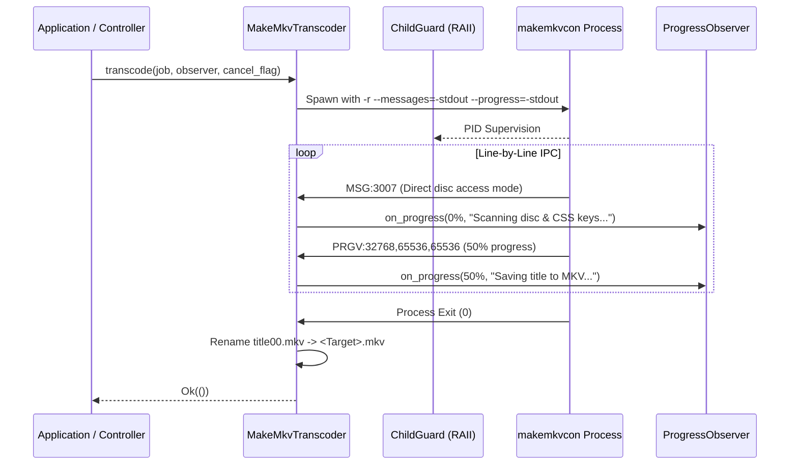

# MakeMKV Robot-Mode Integration Guide - `dvd-ripper`

`dvd-ripper` integrates with the MakeMKV command-line engine (`makemkvcon`) to provide hardware-level optical decryption, AACS/BD+/CSS bus key extraction, and lossless Matroska (`.mkv`) remuxing.

This guide provides deep technical documentation on the robot-mode IPC architecture, pipe deadlock avoidance, progress protocol parsing, multi-episode TV batch workflows, and cross-platform binary auto-discovery.

---

## 1. Architectural Overview

MakeMKV is integrated as a concrete implementation of the domain `Transcoder` port ([`MakeMkvTranscoder`](file:///c:/Users/User/.gemini/antigravity-ide/scratch/dvd-ripper/src/infrastructure/engines/makemkv.rs)):



---

## 2. Process Invocation & Pipe Deadlock Prevention

### 2.1 The Deadlock Problem
In default CLI configurations, `makemkvcon` communicates via multiple streams or uses `--progress=-same` to multiplex progress updates into the standard message stream. In Windows GUI and background service contexts, pipe multiplexing without distinct stdout/stderr separation frequently causes standard I/O buffer deadlocks (where child process write buffers block awaiting reader consumption).

### 2.2 The Solution: Dedicated Robot Streams
`dvd-ripper` executes `makemkvcon` with dedicated stdout robot streaming:

```bash
makemkvcon -r --messages=-stdout --progress=-stdout mkv dev:D: 0 "C:\Media\DVD Rips\Films\Inception (2010)"
```

- `-r`: Enables robot mode (parsable protocol output instead of ANSI terminal graphics).
- `--messages=-stdout`: Directs diagnostic `MSG:` logs to stdout.
- `--progress=-stdout`: Directs progress `PRGV:`, `PRGC:`, and `PRGT:` updates directly to stdout.
- `mkv`: Commands MakeMKV to extract to Matroska format.
- `dev:<DRIVE>`: Specifies the optical hardware device identifier.
- `<TITLE>`: Specifies 0-based title track index (or `all` for batch extraction).
- `<OUT_DIR>`: Target destination folder.

---

## 3. Real-Time Protocol Parsing

The engine parses the MakeMKV line-oriented robot protocol with zero heap allocations:

### 3.1 Progress Percentages (`PRGV`)
Progress lines follow the format:
```text
PRGV:current,total,max
```
Example:
```text
PRGV:32768,65536,65536
```

The zero-allocation parser ([`MakeMkvTranscoder::parse_progress_line`](file:///c:/Users/User/.gemini/antigravity-ide/scratch/dvd-ripper/src/infrastructure/engines/makemkv.rs)):
```rust
pub fn parse_progress_line(line: &str) -> Option<f64> {
    if !line.starts_with("PRGV:") {
        return None;
    }
    let mut parts = line[5..].split(',');
    let first = parts.next()?.trim().parse::<f64>().ok()?;
    let second = parts.next()?.trim().parse::<f64>().ok()?;
    if let Some(third_str) = parts.next() {
        let max = third_str.trim().parse::<f64>().ok()?;
        if max > 0.0 {
            let val = if first > 0.0 { first } else { second };
            return Some(((val / max) * 100.0).clamp(0.0, 99.9));
        }
    } else if second > 0.0 {
        return Some(((first / second) * 100.0).clamp(0.0, 99.9));
    }
    None
}
```

### 3.2 Operation Titles & Disc Scanning Phases (`PRGC` / `MSG`)
- `PRGC:5014,0,"Saving 1 titles"`: Parsed by `parse_operation_title` to inform the user of current operations.
- `MSG:3007`: Signals optical bus authentication and CSS decryption key discovery.
- `MSG:3028`: Signals title discovery and structural layout analysis.
- `MSG:5014`: Signals active stream saving.

---

## 4. Multi-Episode TV Batch Ripping

When ripping TV series discs containing multiple episodes, `dvd-ripper` coordinates MakeMKV with episode naming conventions:

1. **Title Indexing**: When an individual title is selected, MakeMKV receives the 0-based title index (`job.title_number - 1`). When batch mode is triggered, `all` or sequential title calls are dispatched.
2. **File Discovery**: MakeMKV outputs files using internal patterns such as `title00.mkv`, `title_t00.mkv`, or `<DISCLABEL>_t00.mkv`.
3. **MTime Matching**: `MakeMkvTranscoder` snapshots existing files prior to execution and matches newly generated files using file modification timestamps (`mtime >= rip_start_time`).
4. **Target Renaming**: Automatically renames the generated file to the target destination (e.g. `Game of Thrones - S02E09 - Blackwater.mkv`).
5. **Stale Cleanup**: Removes conflicting partial files (e.g. `.native_cells.tmp.vob`) from prior failed attempts to prevent Windows `ERROR_ALREADY_EXISTS`.

---

## 5. Cross-Platform Executable Auto-Discovery

`dvd-ripper` automatically locates `makemkvcon` across standard operating system installation locations:

### Windows
- `%ProgramFiles(x86)%\MakeMKV\makemkvcon64.exe`
- `%ProgramFiles(x86)%\MakeMKV\makemkvcon.exe`
- `%ProgramFiles%\MakeMKV\makemkvcon64.exe`
- `%ProgramFiles%\MakeMKV\makemkvcon.exe`
- Standard system `PATH`

### macOS
- `/Applications/MakeMKV.app/Contents/MacOS/makemkvcon`
- `/usr/local/bin/makemkvcon`
- `/opt/homebrew/bin/makemkvcon`

### Linux
- `/usr/bin/makemkvcon`
- `/usr/local/bin/makemkvcon`

---

## 6. Process Supervision with `ChildGuard`

MakeMKV child processes are wrapped in `ChildGuard` RAII containers. If the user clicks `⏹ Cancel`, or if the parent thread panics, `ChildGuard::drop` immediately issues `SIGKILL` (or `TerminateProcess` on Windows), preventing orphaned background ripping processes from holding exclusive optical drive locks.
