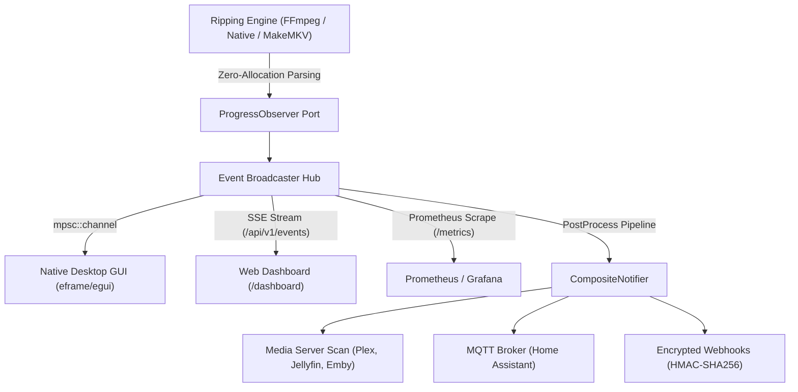

# Telemetry, Metrics & Real-Time Event Streams - `dvd-ripper`

`dvd-ripper` features a decoupled, reactive telemetry and event architecture. Progress updates, diagnostic logs, and completion signals can be streamed simultaneously to the desktop GUI, remote web browsers, media servers, and smart home automation systems.

This document describes the event lifecycle, observer contracts, Server-Sent Events (SSE) broadcasting, Prometheus metrics scraping, and external integration hooks.

---

## 1. Event Pipeline Architecture



---

## 2. Core Event Entities

### 2.1 The `ProgressEvent` Enum
Defined in [`src/domain/entities/job.rs`](file:///c:/Users/User/.gemini/antigravity-ide/scratch/dvd-ripper/src/domain/entities/job.rs):

```rust
pub enum ProgressEvent {
    Progress {
        percent: f64,
        fps: String,
        speed: String,
    },
    Log(String),
    TitleStart(u32),
    TitleComplete(u32, PathBuf),
    Error(String),
}
```

### 2.2 The `ProgressObserver` Port
Defined in [`src/domain/ports/transcoder.rs`](file:///c:/Users/User/.gemini/antigravity-ide/scratch/dvd-ripper/src/domain/ports/transcoder.rs):

```rust
pub trait ProgressObserver: Send + Sync {
    fn on_progress(&self, percent: f64, fps: &str, speed: &str);
    fn on_log(&self, line: &str);
    fn on_title_start(&self, title_num: u32) {}
    fn on_title_complete(&self, title_num: u32, output_path: &Path) {}
}
```

---

## 3. Server-Sent Events (SSE) Broadcast Engine

When running in appliance daemon mode (`--daemon`) or with the HTTP server active (`--api`), `dvd-ripper` streams real-time JSON events over standard HTTP SSE connections at `/api/v1/events`.

### 3.1 Concurrency & Rate Limiting
- **Max Connections**: Bounded to 32 concurrent HTTP clients (`MAX_CONCURRENT_API_CONNECTIONS = 32`). Excess clients receive `HTTP 503 Service Unavailable`.
- **Slowloris Protection**: Sockets enforce a strict 10-second timeout on all read and write operations.
- **Client Heartbeats**: Broadcasts periodic keep-alive comments (`: keep-alive\n\n`) to prevent intermediate reverse proxy timeouts.

### 3.2 SSE Event Wire Format
```http
HTTP/1.1 200 OK
Content-Type: text/event-stream
Cache-Control: no-cache
Connection: keep-alive

data: {"type":"progress","percent":42.5,"fps":"58.2","speed":"2.3x"}

data: {"type":"log","message":"[MakeMKV] Saving title 0 into MKV..."}

data: {"type":"title_complete","title_num":1,"output_path":"/media/Movies/Inception (2010).mkv"}
```

---

## 4. Prometheus Metrics Exporter

`dvd-ripper` natively exports Prometheus-compatible time-series metrics on `/metrics`:

```prometheus
# HELP dvd_ripper_rips_total Total number of DVD rip jobs attempted.
# TYPE dvd_ripper_rips_total counter
dvd_ripper_rips_total 12

# HELP dvd_ripper_rips_failed Total number of failed rip jobs.
# TYPE dvd_ripper_rips_failed counter
dvd_ripper_rips_failed 0

# HELP dvd_ripper_bytes_read_total Total raw optical bytes processed.
# TYPE dvd_ripper_bytes_read_total counter
dvd_ripper_bytes_read_total 54829104128

# HELP dvd_ripper_active_connections Current active HTTP client connections.
# TYPE dvd_ripper_active_connections gauge
dvd_ripper_active_connections 2
```

---

## 5. Notification Adapters

### 5.1 Media Server Library Scans
Automatically notifies media server libraries to ingest newly ripped movies or TV episodes:
- **Plex**: `POST /library/sections/{id}/refresh?X-Plex-Token={token}`
- **Jellyfin / Emby**: `POST /Library/Refresh?api_key={key}`

### 5.2 MQTT Home Automation
Publishes real-time telemetry to MQTT topics for Home Assistant dashboards:
- Topic: `homeassistant/sensor/dvd_ripper/state`
- Topic: `homeassistant/sensor/dvd_ripper/progress`

### 5.3 HMAC-SHA256 Authenticated Webhooks
Dispatches signed JSON payloads to custom endpoints with `X-Hub-Signature-256` verification headers to secure automation pipelines against spoofing.
