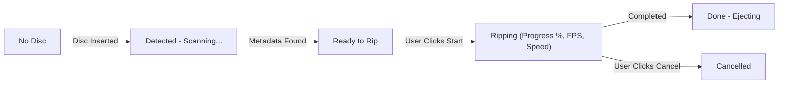

# UI Usability Heuristics Specification - `dvd-ripper`

`dvd-ripper`'s native desktop GUI (built with [`eframe`/`egui`](https://github.com/emilk/egui)) and responsive embedded Web Dashboard (`http://localhost:8080/dashboard`) are engineered according to **Jakob Nielsen’s 10 Usability Heuristics** (as referenced in [`notes/UI.md`](file:///c:/Users/User/.gemini/antigravity-ide/scratch/dvd-ripper/notes/UI.md)).

This document provides a concrete architectural mapping of each usability heuristic to its implementation across the user interface.

---

## 1. Visibility of System Status

> *The application should always keep users informed about what is happening behind the scenes, providing immediate and appropriate feedback within a reasonable timeframe.*

### Implementation:
- **Live Progress Gauges**: Displays active progress percentage (`0.0%` to `100.0%`), current encoding FPS, read speed multiplier (`2.4x`), and elapsed/estimated remaining time.
- **Hardware Status Badges**: Clear visual status indicators (`No Disc`, `Detected - Search Required`, `Ready`, `Ripping`, `Done`, `Error`).
- **Server-Sent Events (SSE)**: The Web Dashboard receives real-time telemetry from `/api/events` every second, updating progress without full-page reloads or polling latency.
- **Live Log Streaming**: Stderr and engine diagnostics stream in real time into an expandable console view.

---

## 2. Match Between System and the Real World

> *Speak the user's language by using words, phrases, and concepts familiar to them rather than internal jargon. Follow real-world conventions so information flows naturally.*

### Implementation:
- **Optical Disc Terminology**: Uses standard physical media concepts: *Volume Label*, *Title Tracks*, *Chapters*, and *Audio Streams* (e.g., `Track #1: ENG (AC3 5.1)`).
- **Media Server Taxonomies**: Output folder naming follows Plex, Jellyfin, and Emby industry conventions (`Films/<Title> (<Year>)/...` and `TV/<Show> (<Year>)/Season <SS>/...`).
- **Universal Iconography**: Recognizable visual metaphors:
  - `📂 Browse...` for folder selection.
  - `↗ Open` to launch target directories in Windows Explorer / macOS Finder.
  - `↺ Reset` to restore sensible default paths.
  - `▶ Start Rip` and `⏹ Cancel` for playback/recording control.
  - `⏏ Eject` for tray control.

---

## 3. User Control and Freedom

> *Users often make mistakes and need a clearly marked "emergency exit" to leave unwanted actions immediately without an extended dialogue.*

### Implementation:
- **Cooperative Cancellation**: Clicking `⏹ Cancel` immediately trips an `Arc<AtomicBool>` cancellation token. Active transcode processes (`ffmpeg`, `HandBrakeCLI`, `makemkvcon`) are safely terminated in <100ms via `ChildGuard`.
- **Immediate Optical Eject**: A dedicated `⏏ Eject` button is always accessible, allowing users to physically eject stuck discs at any time.
- **Path Resetting**: Every customizable folder path features a `↺ Reset` button to immediately undo accidental changes.

---

## 4. Consistency and Standards

> *Users should not have to wonder whether different words, situations, or actions mean the same thing. Follow platform conventions and design systems.*

### Implementation:
- **Unified Navigation Tabs**: The desktop interface is divided into consistent, single-responsibility tabs:
  - `💿 Rip`: Active drive, title selection, and live ripping progress.
  - `📋 Queue`: Asynchronous batch job queue and autoloader coordination.
  - `📦 BoxSets`: TV season multi-disc tracking.
  - `📜 History`: Completed rip records and audit logs.
  - `⚙ Settings`: Directory preferences, hardware acceleration, and acoustic profiles.
  - `🔍 Diagnostics`: Drive benchmarking and copy-protection scanning.
- **Platform File Dialogs**: Invokes OS-native file pickers via `rfd` (Windows File Explorer, macOS NSOpenPanel, Linux GTK Portal).

---

## 5. Error Prevention

> *Even better than good error messages is a design that carefully prevents problems from occurring in the first place.*

### Implementation:
- **Start Rip Guard**: The `▶ Start Rip` button is strictly disabled and grayed out until:
  1. An optical disc is physically loaded in the drive.
  2. Disc titles have been successfully probed.
  3. Online movie/TV candidate selection is confirmed.
- **Pre-Flight Disk Space Guard**: Before launching any ripping process, [`check_free_space`](file:///c:/Users/User/.gemini/antigravity-ide/scratch/dvd-ripper/src/domain/ports/storage.rs) verifies that the target partition has sufficient free space (`--min-free-gb 10`), preventing partial rips and out-of-space crashes.
- **Overwrite Collisions**: The `--no-overwrite` option automatically appends numeric suffixes (`Movie_1.mp4`, `Movie_2.mp4`) instead of silently destroying existing files.

---

## 6. Recognition Rather Than Recall

> *Minimize the user's memory load by making elements, actions, and options visible. The user should not have to remember information across different screens.*

### Implementation:
- **Visual Title Thumbnails**: The GUI displays instant JPEG video frame thumbnails captured from title tracks, allowing users to visually verify the feature film versus bonus features.
- **Metadata Candidate Search Modal**: When an optical volume label is ambiguous, a popup modal presents online search candidates complete with high-resolution poster artwork, release years, directors, and plot summaries.
- **Ripping History Ledger**: The `📜 History` tab keeps past rip logs visible and searchable, eliminating the need to remember previously processed discs.

---

## 7. Flexibility and Efficiency of Use

> *Design the application to cater to both novice and expert users with shortcuts, accelerators, and advanced configurations.*

### Implementation:
- **Dual Execution Interfaces**: Novice users benefit from the one-click desktop GUI, while advanced users and homelab sysadmins can execute terminal commands (`--cli`) or run headless daemon services (`--daemon`).
- **Acoustic Profile Selection**: Instant switching between `silent` (4x speed for quiet living rooms) and `turbo` (16x speed for maximum archival throughput).
- **Multi-Drive Pooling**: Expert users with multiple optical drives can monitor and rip across all drives concurrently (`--drive-pool "D:,E:,F:"`).

---

## 8. Aesthetic and Minimalist Design

> *Interfaces should not contain information that is irrelevant or rarely needed. Every extra unit of information competes with relevant information.*

### Implementation:
- **Dark-Mode Aesthetic**: Styled using egui's dark theme with clean visual contrast, generous whitespace, and readable typography.
- **Progressive Disclosure**: Advanced video filter options (CRF slider, IVTC de-telecine, 3D denoising, crop coordinates) are collapsed by default under expandable sections, ensuring the primary interface remains focused on core ripping tasks.

---

## 9. Help Users Recognize, Diagnose, and Recover from Errors

> *Error messages should be expressed in plain language (no technical codes), precisely indicate the problem, and constructively suggest a solution.*

### Implementation:
- **Plain-Language Diagnostics**:
  - *Bad Sector Warning*: *"Damaged optical sector encountered at 45.2%. Attempting auto-fallback to Native IFO cell extractor."*
  - *Insufficient Space*: *"Insufficient disk space on target drive: 3.4 GB available, 10.0 GB required. Free up space or select a different output directory."*
- **Auto-Fallback Recovery**: When FFmpeg fails on protected or scratched DVDs, the system automatically advances down the priority cascade ($\text{FFmpeg} \to \text{Native IFO} \to \text{HandBrake} \to \text{MakeMKV}$) without halting the application.

---

## 10. Help and Documentation

> *Provide information that is easy to search, focused on the user's task, and lists concrete steps.*

### Implementation:
- **Inline Tooltips**: Every checkbox, slider, and button in the GUI features descriptive hover tooltips explaining the function, recommended settings, and CLI flag equivalents.
- **Embedded Web Documentation**: The Web Dashboard includes direct navigation to the OpenAPI interactive documentation (`/api/openapi.json`), health metrics (`/metrics`), and troubleshooting guides.
- **Comprehensive CLI Help**: Detailed terminal documentation via `dvd-ripper --help`.
